# 🧃 Vietnam Juice Export Analysis – Power BI Dashboard

> **Phân tích dữ liệu hải quan xuất khẩu FMCG để đánh giá cơ hội đưa dòng Juice OEM Việt Nam vào thị trường Hoa Kỳ**


Dự án thực hiện trong kỳ thực tập 8 tuần ở vị trí **Data Analyst** tại một công ty giải pháp phân tích dữ liệu (02–08/2026).

---

## 📌 Bài toán kinh doanh

Một doanh nghiệp sản xuất nước ép theo hình thức OEM muốn mở rộng sang Mỹ và cần trả lời 5 câu hỏi:

1. Nên bán **sản phẩm Juice nào** tại Mỹ?
2. **Định giá** ở mức nào?
3. **Cạnh tranh** với những doanh nghiệp Việt Nam nào?
4. **Nhà nhập khẩu** nào có khả năng mua?
5. **Rào cản logistics** khi đưa hàng từ Việt Nam sang Mỹ là gì?

Mình rà 27 mục yêu cầu của tài liệu tổng quan và đối chiếu với dữ liệu sẵn có, rồi chia làm hai nhóm: các mục **xây dựng được trực tiếp từ dữ liệu hải quan** và các mục **cần thêm dữ liệu bên ngoài** (giá bán lẻ, pháp lý, biểu thuế HTS của Mỹ). Dự án chỉ triển khai nhóm thứ nhất.

---

## 🗂️ Dữ liệu

| Thuộc tính | Giá trị |
|---|---|
| Nguồn | Tờ khai hải quan xuất khẩu của Việt Nam, **Chương 20** (rau quả chế biến) |
| Thời gian | 03/02/2026 – 31/08/2026 (7 file theo tháng) |
| Quy mô | **101.977 dòng × 42 cột** |
| Phạm vi | 1.257 doanh nghiệp xuất khẩu · 5.734 nhà nhập khẩu · 168 thị trường |
| Lọc Juice | HS Code nhóm **2009** (23 mã HS 8 chữ số) → 25.480 dòng |

**Các vấn đề chất lượng dữ liệu đã phát hiện và xử lý:**
- **31 loại đơn vị tính** (Kg, Lít, Thùng, Barrel…) và chưa có bảng quy đổi → sản lượng và đơn giá chỉ so sánh trong cùng một đơn vị.
- **5 dòng nghi khai sai đơn giá** (> 100 USD/kg, tổng ~34,3 triệu USD; một dòng khai tới 1.445 USD/kg) → bị loại theo BRD. Nếu giữ lại, xếp hạng Top 5 thị trường sẽ sai.
- **Phân phối đơn giá lệch mạnh**: trung vị ~5,65 USD nhưng trung bình ~47,82 USD → dùng thêm Median, P25, P75 thay vì chỉ dùng Average.
- **Tên doanh nghiệp viết không thống nhất** → chuẩn hóa thử giúp giảm số nhà nhập khẩu từ 1.879 xuống 1.761.
- **Giá trị thiếu hoặc nhập sai**: 7.161 dòng để trống quốc gia nhập khẩu, 2.303 dòng ghi sai mã nguyên tệ, 96,9% dòng thiếu thông tin nhà sản xuất…
- **Cột trùng lặp hoặc không có giá trị phân tích** (Tháng/Month giống hệt nhau, cột thuế suất chỉ có giá trị 0).

---

## 🔄 Quy trình thực hiện

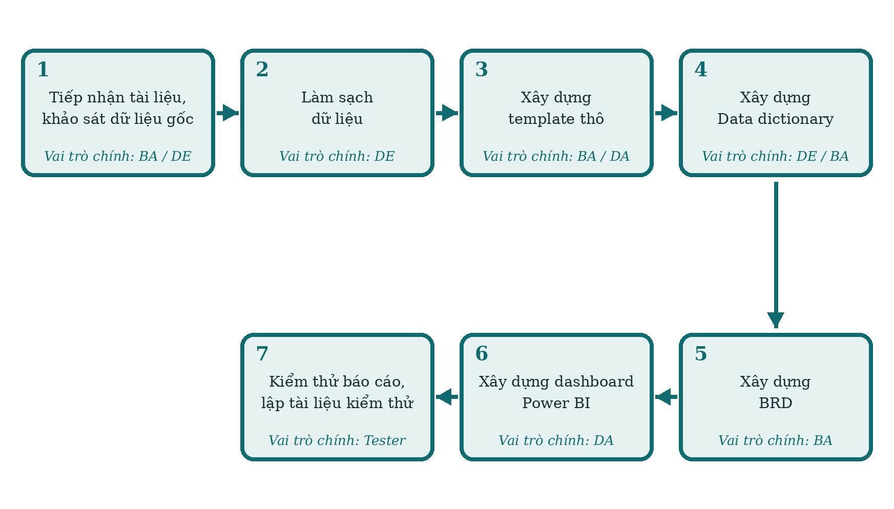

### Bước 1 – Khảo sát yêu cầu & dữ liệu gốc
Đọc tài liệu tổng quan (27 mục yêu cầu), đối chiếu từng mục với dữ liệu hiện có để xác định phần nào làm được từ dữ liệu hải quan, phần nào cần dữ liệu ngoài. Mở 7 file dữ liệu theo tháng để nắm cấu trúc cột và phạm vi thời gian.

<!-- Ảnh minh họa bước 1 (tùy chọn): bảng đối chiếu yêu cầu ↔ dữ liệu
 -->

### Bước 2 – Làm sạch dữ liệu
Hợp nhất 7 file thành một bảng thống nhất **101.977 dòng × 42 cột**, rà soát tên cột, kiểu dữ liệu, giá trị bất thường; tạo thêm các trường phân loại (nhóm sản phẩm, loại trái cây, khu vực thị trường).

<!-- Ảnh minh họa bước 2 (tùy chọn): các bước xử lý trong Power Query
 -->

### Bước 3 – Xây dựng template báo cáo
Thiết kế danh mục 8 báo cáo và wireframe cho từng trang (bộ lọc, thẻ KPI, biểu đồ) để thống nhất bố cục trước khi viết yêu cầu chi tiết.

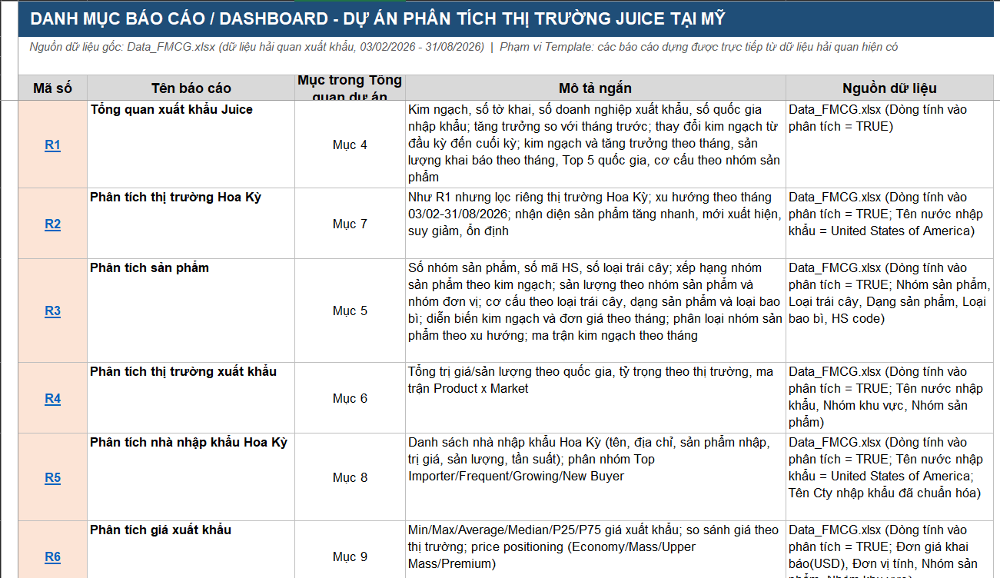
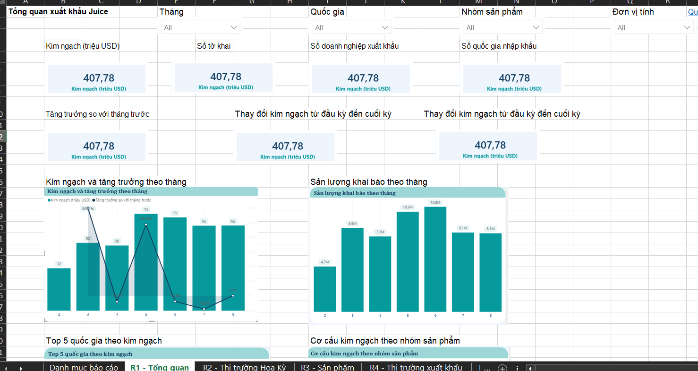

### Bước 4 – Data Dictionary
Mô tả 42 trường gốc + 23 trường bổ sung: tên chuẩn (VD `Trị giá USD → ValueUSD`), kiểu dữ liệu, tỷ lệ thiếu, lỗi phát hiện và trang báo cáo sử dụng.

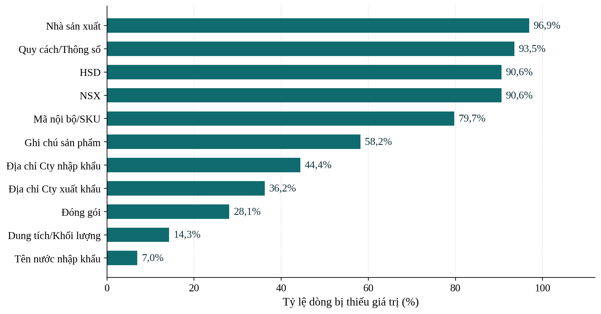

### Bước 5 – BRD (Business Requirement Document)
Đặc tả yêu cầu cho từng báo cáo: điều kiện ràng buộc, bộ lọc, KPI và công thức tính. Các chỉ tiêu chưa có ngưỡng định nghĩa được ghi chú chờ xác nhận thay vì tự suy diễn.

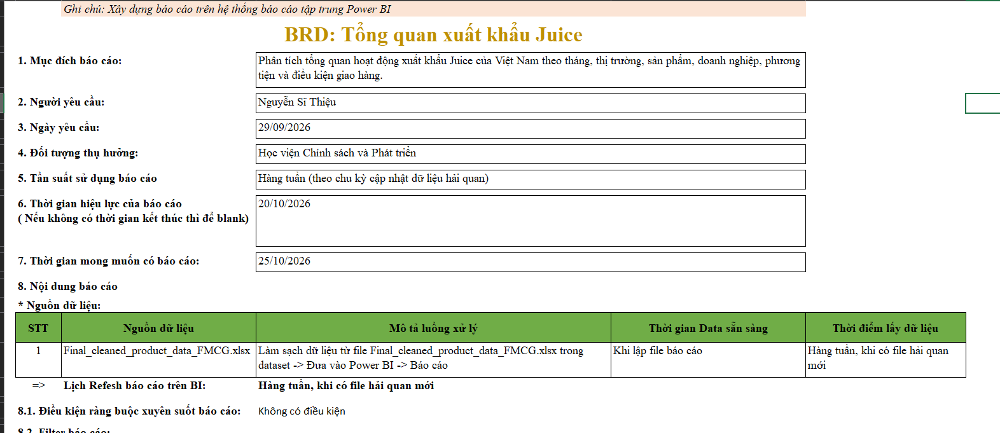

### Bước 6 – Dashboard Power BI
Power Query → mô hình dữ liệu hình sao → DAX measures → thiết kế giao diện 8 trang theo template (xem chi tiết phần Dashboard bên dưới).

### Bước 7 – Kiểm thử
52 test case bám BRD, đối chiếu từng thẻ KPI/biểu đồ với giá trị tính độc lập bằng Python (xem phần Kiểm thử bên dưới).

---

## 📊 Dashboard – 8 trang báo cáo

Mỗi trang dùng chung 4 bộ lọc: **Tháng · Quốc gia · Nhóm sản phẩm · Đơn vị tính**, điều hướng qua menu bên trái.

### R1 – Tổng quan xuất khẩu Juice
Kim ngạch, số tờ khai, số doanh nghiệp, số quốc gia, tăng trưởng MoM, Top 5 thị trường, cơ cấu nhóm sản phẩm.

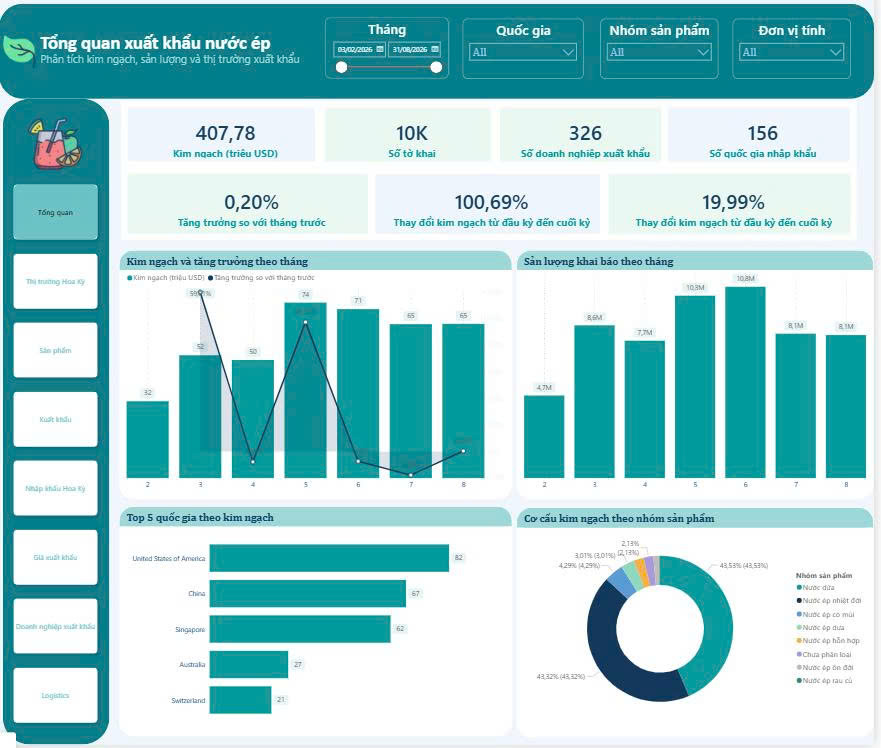

### R2 – Phân tích thị trường Hoa Kỳ
Kim ngạch sang Mỹ, nhà nhập khẩu, sản phẩm mới / tăng nhanh / suy giảm.

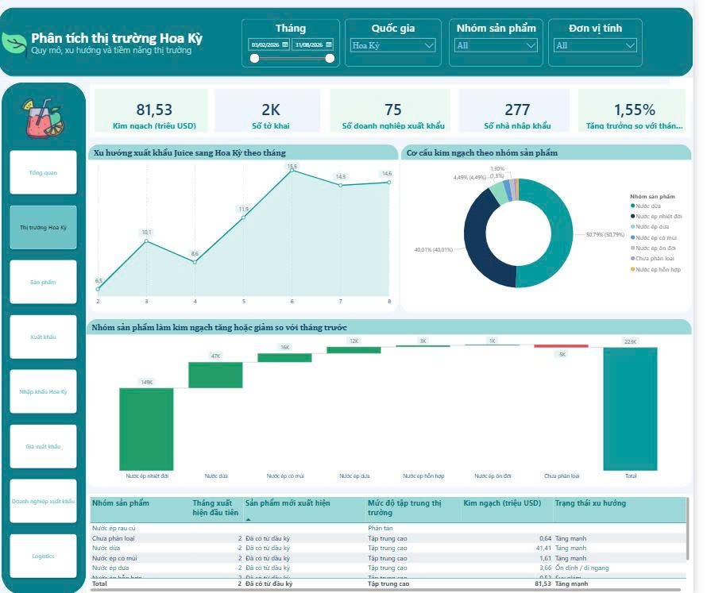

### R3 – Phân tích sản phẩm
Cơ cấu và xu hướng theo sản phẩm, phân nhóm theo tốc độ tăng trưởng.

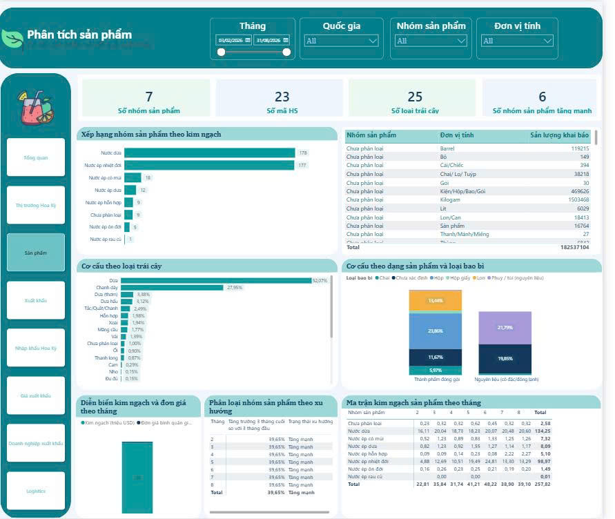

### R4 – Phân tích thị trường xuất khẩu
Tỷ trọng theo quốc gia, ma trận sản phẩm × khu vực.

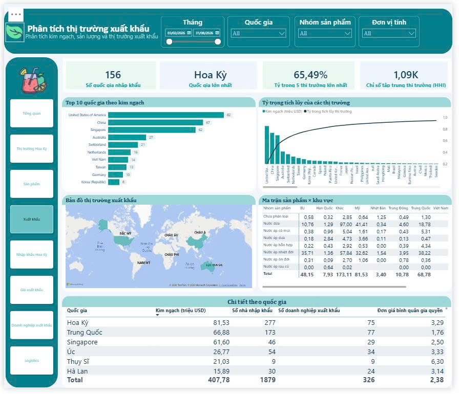

### R5 – Phân tích nhà nhập khẩu Hoa Kỳ
277 nhà nhập khẩu, mức độ tập trung (Pareto), tần suất mua, khách mới vs. khách thường xuyên.

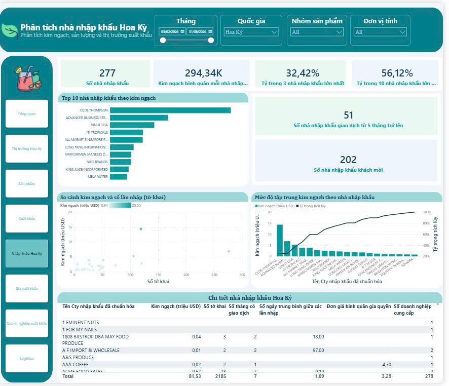

### R6 – Phân tích giá xuất khẩu
Min, P25, Median, P75, Max, đơn giá bình quân gia quyền, phân bố giá.

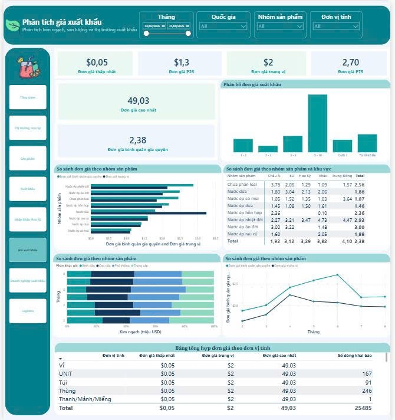

### R7 – Phân tích doanh nghiệp xuất khẩu
Thị phần, ma trận cạnh tranh, doanh nghiệp Việt Nam xuất sang Mỹ.

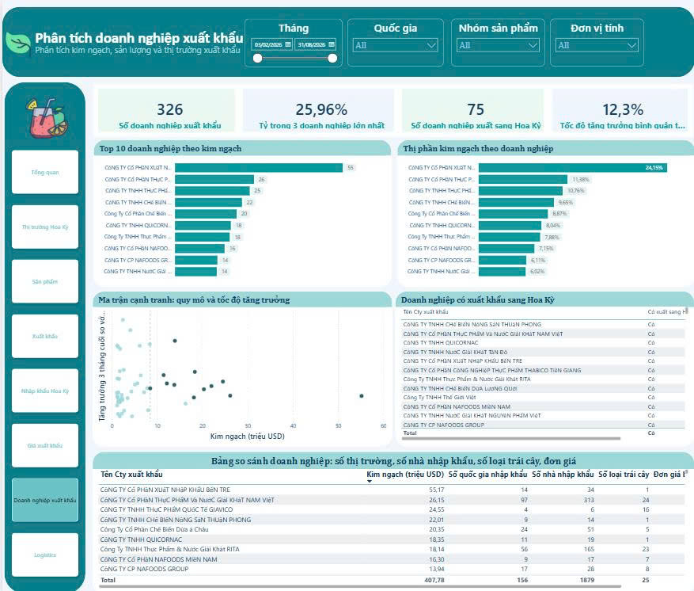

### R8 – Phân tích logistics
Điều kiện giao hàng (Incoterms), phương tiện vận chuyển, tờ khai.

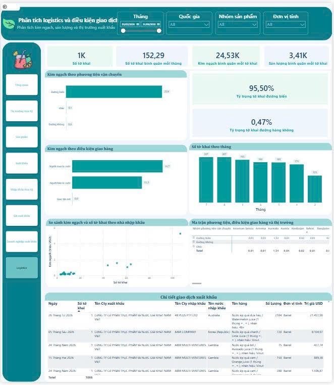

### Một số DAX measure tiêu biểu

```dax
Trị giá XK      = SUM ( Fact_Export[ValueUSD] )

Số tờ khai      = DISTINCTCOUNT ( Fact_Export[DeclarationNumber] )

Trị giá tháng trước =
    CALCULATE ( [Trị giá XK], DATEADD ( Dim_Date[Date], -1, MONTH ) )

Growth MoM      = DIVIDE ( [Trị giá XK] - [Trị giá tháng trước], [Trị giá tháng trước] )

Tỷ trọng nhóm SP =
    DIVIDE ( [Trị giá XK], CALCULATE ( [Trị giá XK], ALL ( Dim_Product ) ) )

Giá P25         = PERCENTILE.INC ( Fact_Export[UnitPriceUSD], 0.25 )
```

---

## 💡 Insight chính

- 🧃 Nhóm Juice có kim ngạch **~407,8 triệu USD** trong 7 tháng, với **326 doanh nghiệp xuất khẩu**, **9.903 tờ khai** và **155 thị trường**.
- 🇺🇸 **Hoa Kỳ là thị trường lớn nhất**: ~81,5 triệu USD, chiếm **20,0%** tổng kim ngạch. Xếp sau là Trung Quốc (16,4%), Singapore (15,1%), Úc (6,6%) và Thụy Sĩ (5,2%).
- 📈 Kim ngạch sang Mỹ **tăng hơn gấp đôi**, từ 6,5 triệu USD (tháng 2) lên 14,6 triệu USD (tháng 8).
- 🥥 **Nước dừa (43,5%)** và **nước ép trái cây nhiệt đới (43,3%)** chiếm gần 87% cơ cấu kim ngạch.
- 🤝 Thị trường Mỹ có **277 nhà nhập khẩu** và **75 doanh nghiệp Việt Nam** cùng tham gia, tức là cơ hội lớn nhưng cạnh tranh cũng đáng kể.

**Giới hạn:** dữ liệu chỉ phản ánh phía xuất khẩu của Việt Nam trong 7 tháng, chưa đủ để đánh giá tính mùa vụ hay đưa ra quyết định "go / no-go". Để kết luận cần bổ sung dữ liệu nhập khẩu của Mỹ từ mọi quốc gia, giá bán lẻ, quy định FDA và biểu thuế HTS.

---

## ✅ Kiểm thử dữ liệu

Mình không dừng ở việc "dashboard chạy được" mà kiểm tra để chắc chắn **số liệu đúng**:

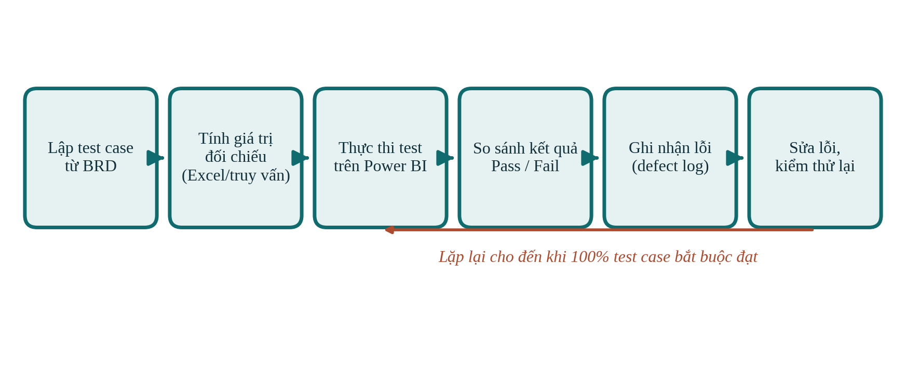

- Viết **52 test case** bám theo BRD, từ 5 đến 8 case cho mỗi báo cáo.
- Dùng **Python (pandas)** tính giá trị tham chiếu độc lập từ dữ liệu nguồn, áp dụng cùng bộ điều kiện lọc với dashboard.
- Kiểm tra các tổ hợp bộ lọc đại diện: không lọc, lọc một chiều, lọc nhiều chiều và lọc cho kết quả rỗng.

---

## 🛠️ Công cụ & kỹ năng

| Công cụ | Ứng dụng |
|---|---|
| **Power BI Desktop + DAX** | Mô hình hình sao, measure theo ngữ cảnh lọc, dashboard tương tác |
| **Power Query** | ETL: hợp nhất file, đổi tên cột, chuẩn hóa kiểu dữ liệu, tạo trường phân loại |
| **Python (pandas)** | Tính giá trị tham chiếu để kiểm thử |
| **Excel** | Khảo sát dữ liệu, Data Dictionary, BRD, test case |

**Kỹ năng thể hiện:** Requirement Analysis (BRD) · Data Cleaning · Data Quality Assessment · Data Modeling · DAX · Dashboard Design · Data Testing / QA · Business Storytelling

---

## 📬 Liên hệ

**Nguyễn Quốc Dũng** – Data Analyst
GitHub: [@qdunq05](https://github.com/qdunq05)
